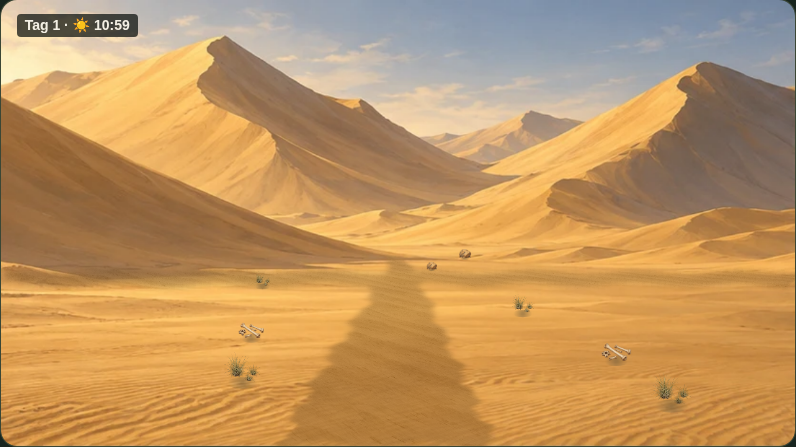
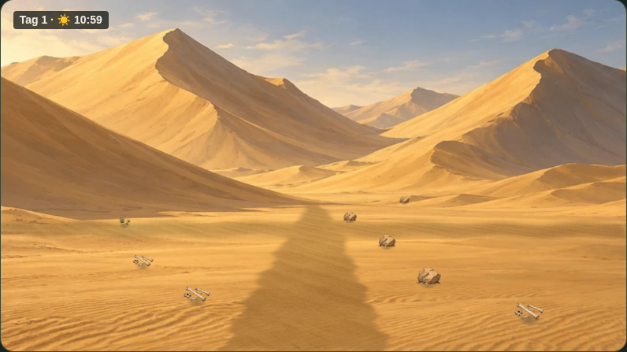
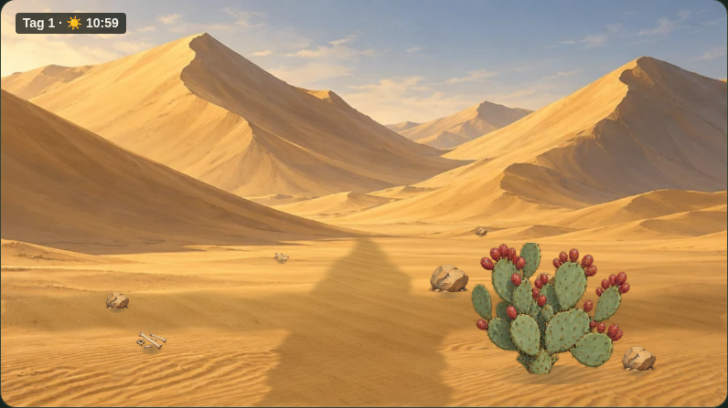
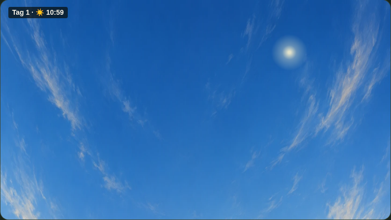
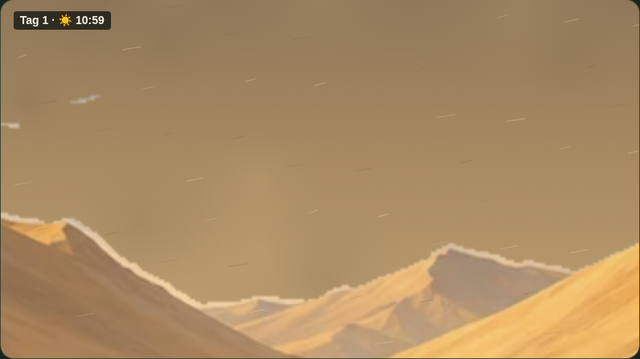
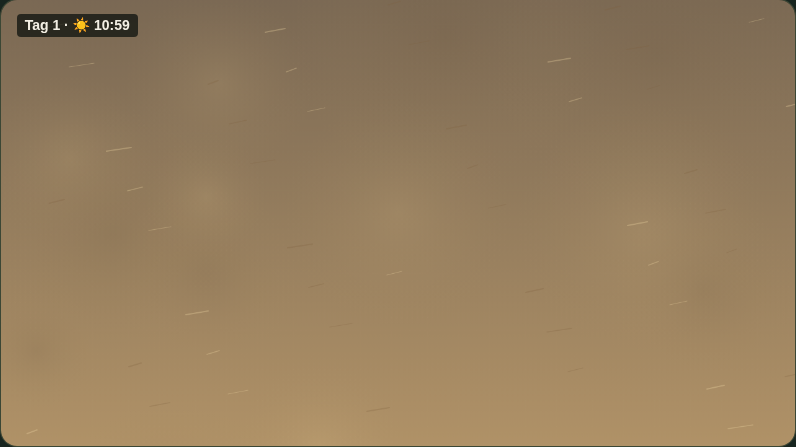
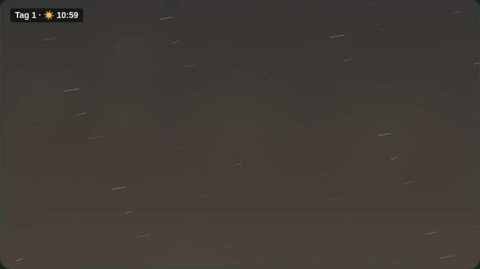

# Version 16.2 – Kreuzung und Wetter

[Kurze Spielaufnahme herunterladen](Kreuzung-und-Sandsturm.mp4): drei tatsächliche F/J-Schritte zur Kaktuskreuzung, O zum Himmel, Leertaste zurück, dann Sandsturm und E zum Eingraben. Die Aufnahme zeigt das Spielfenster bei 1280 × 1000 Browsergröße.

## Kreuzung im kleineren Spielfenster

Die folgenden Bilder entstehen nach jeweils einer tatsächlich gedrückten Schritttaste.

## Himmelsblick

Geprüft mit tatsächlichen O-/Leertasten und 20 Kamerastufen bei Tag, Nacht, Sturmwarnung, Tagsturm und Nachtsturm. Zusätzliche Prüfungen: Pause, während des Himmelsblicks beginnender Sturm, E und fünf Ü-Eingaben, ursprüngliche Ausgänge und gespeicherte Spielstände ohne Veränderungen durch das Zeichnen.
