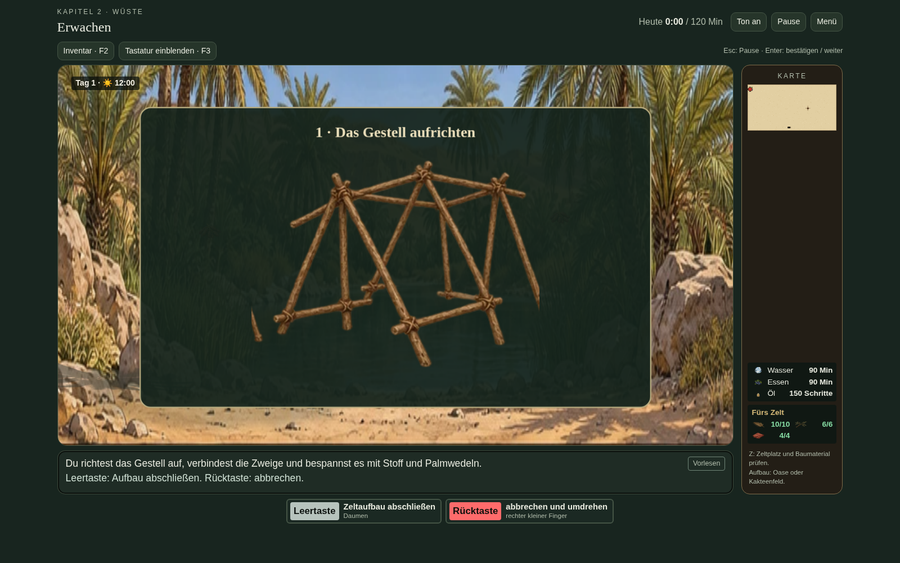
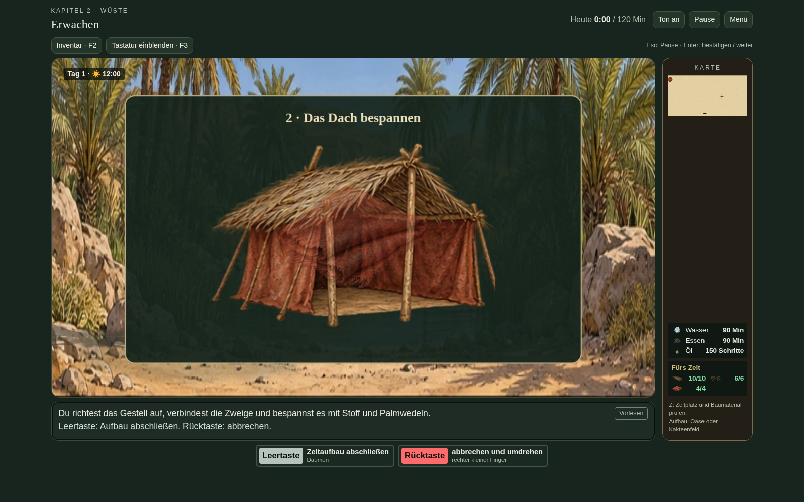
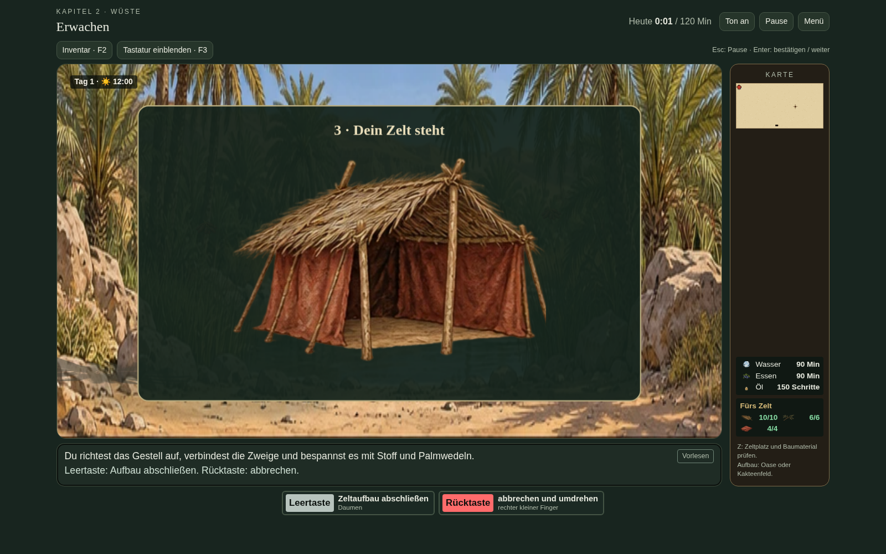
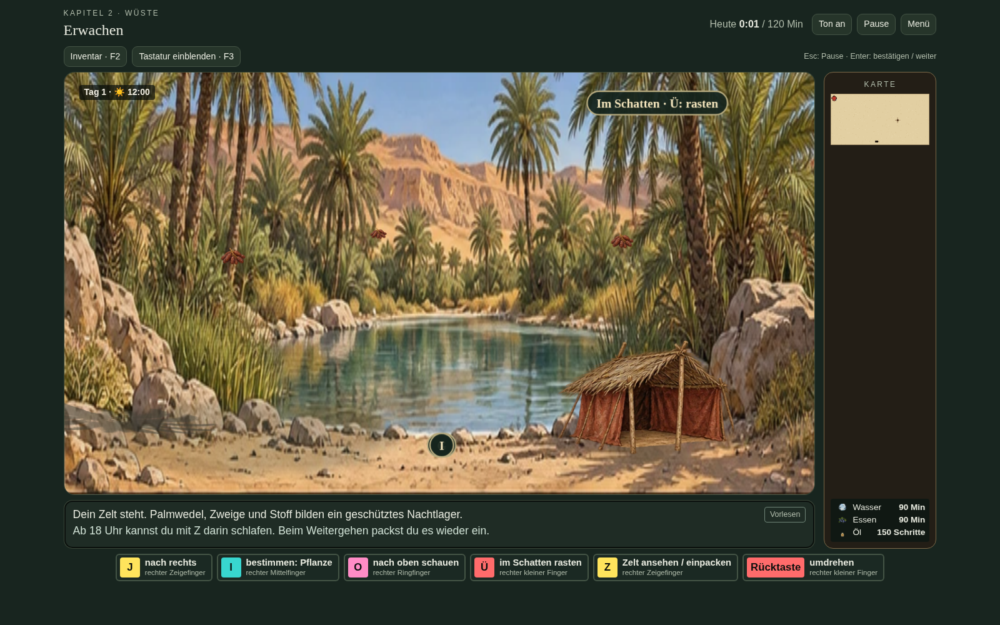
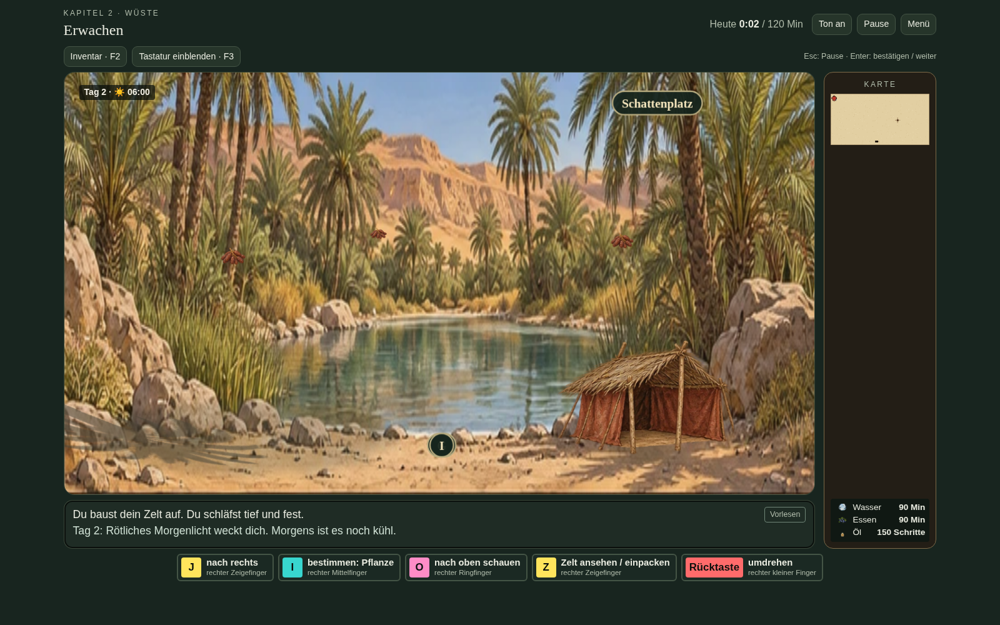

# Version 17.1 – Zeltaufbau

Z zeigt die Zeltaktion in der Wüste. An Oase und Kakteenfeld kann das Zelt bereits tagsüber aufgebaut werden. Benötigt werden 10 Palmwedel, 6 Akazienzweige und 4 Stück Stoff. Leertaste schließt ab, Rücktaste bricht ohne Materialverbrauch ab.

## Drei Aufbauschritte

## Zelt am Lagerplatz

Das fertige Zelt wird im Inventar geführt und bleibt am Lagerplatz nach Speichern/Neuladen sichtbar. Beim Weitergehen wird es eingepackt. Beim Wiederverwenden wird kein weiteres Material verbraucht.

## Nacht und Morgen

Ab 18 Uhr bietet Z das Schlafen an. Die Sequenz blendet durch Nacht und Morgen. Leertaste kann sie abschließen. Die ursprüngliche Übernachtung führt genau einen Tageswechsel aus.

`check-tent-v17-1.py` prüft tatsächliche Tasten, Materialmangel, ungeeignete Plätze, alle Blickrichtungen, Aufbau, Abbruch, Pause, Speichern/Neuladen, Einpacken und Wiederverwenden, den ersten Abendaufbau sowie den ursprünglichen Höhlenschlaf. Die Prüfung wurde auch gegen die eigenständige exportierte HTML-Datei ausgeführt.
