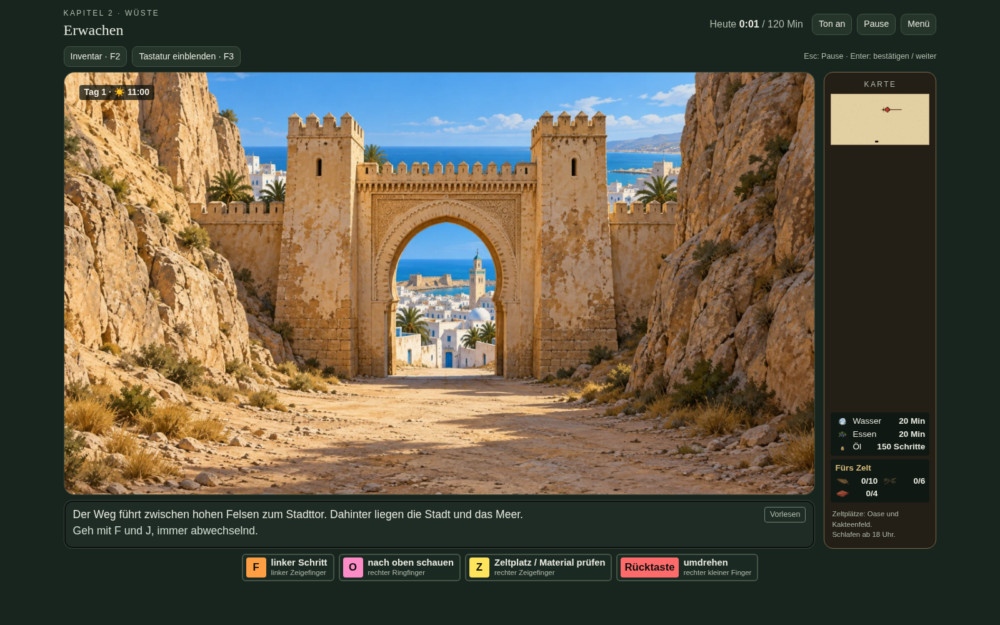
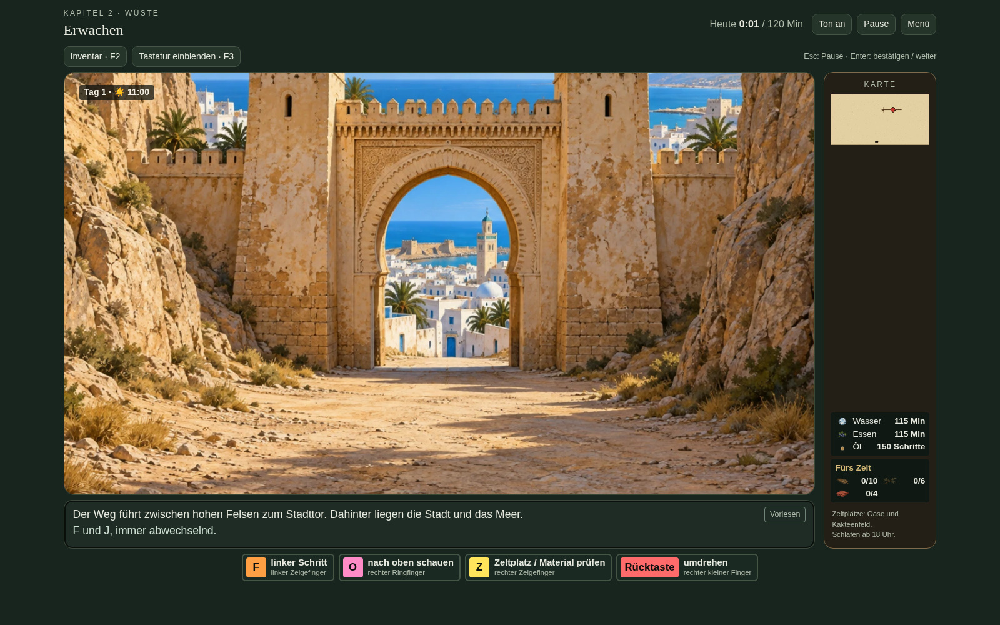
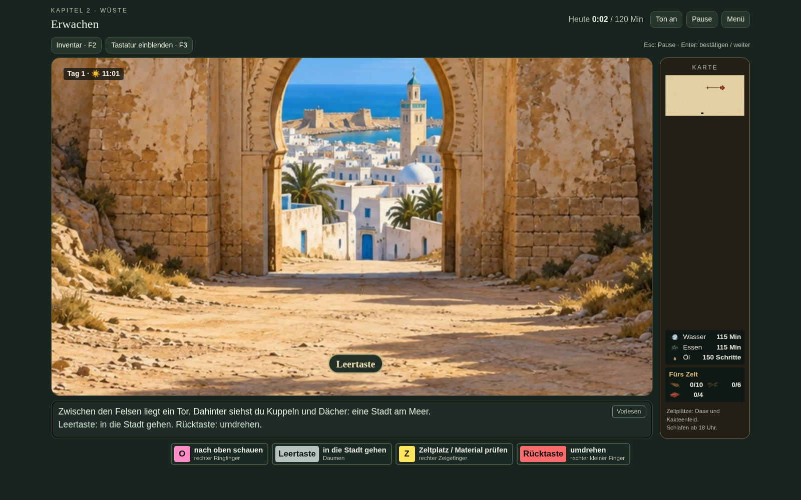
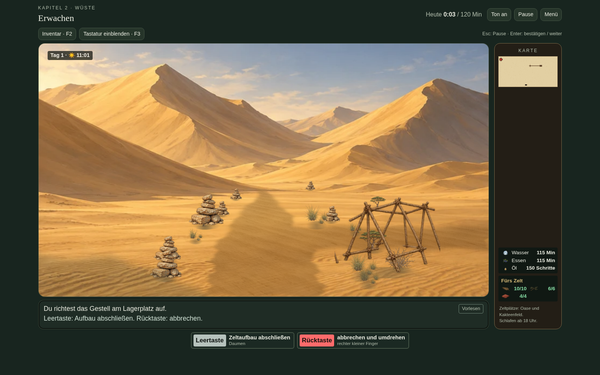
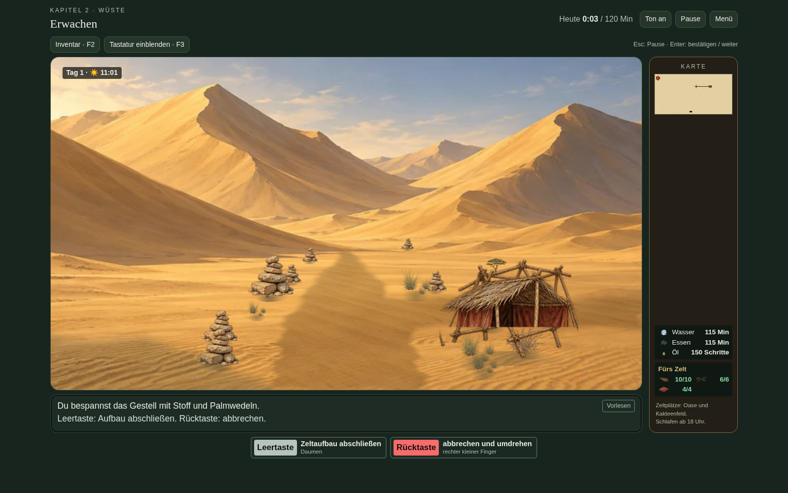
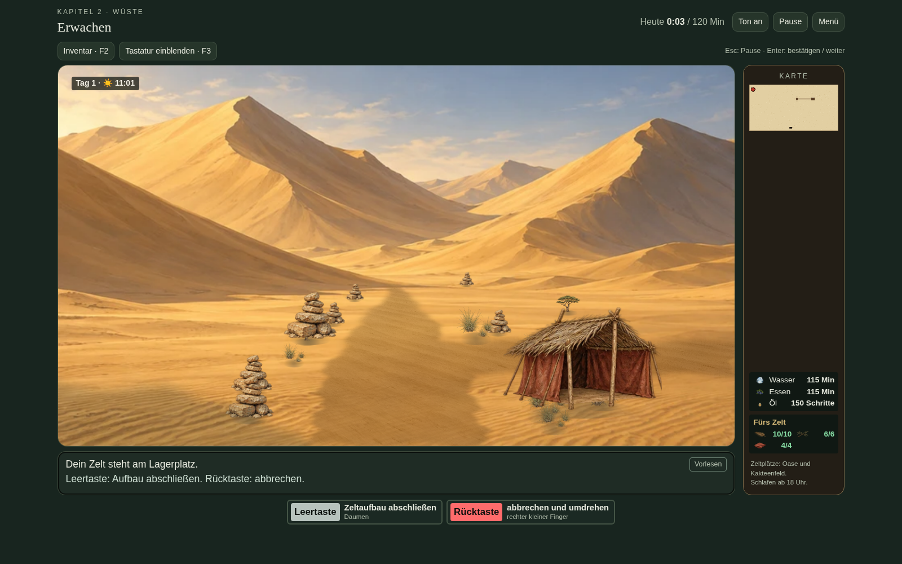
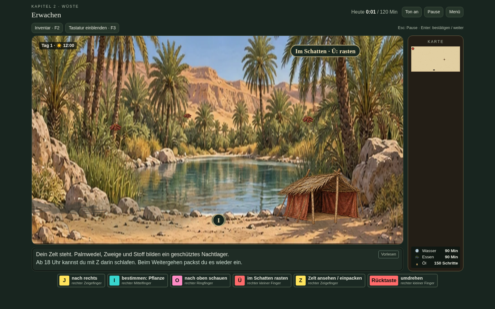

# Version 17.2 – Zelt in der Landschaft und Stadtweg

## Tatsächlicher Weg zur Stadt

[Kurze Spielaufnahme des Stadtwegs herunterladen](Stadtweg.mp4)

Die Aufnahme zeigt das tatsächliche Abbiegen und alle fünf folgenden F/J-Schritte. Jeder Schritt führt die Kamera näher an das Tor. Der Bildausschnitt springt nach dem Schritt nicht mehr zurück.

## Zeltaufbau ohne zusätzliches Fenster

Die Aufbauschritte stehen direkt am Lagerplatz in derselben Größe und Position wie das fertige Zelt.

Geprüft: reale F/J-Schritte, Pause während der Annäherung, zwei schnell eingegebene Schritte, alle Aufbauschritte ohne Fensterzeichnung, identische Zeltposition vor/nach dem Abschluss sowie Materialverbrauch, Abbruch, Inventar, Speichern/Neuladen, Wiederverwenden und Übernachtung. Der eigenständige Export wurde ebenfalls im Browser geprüft.
