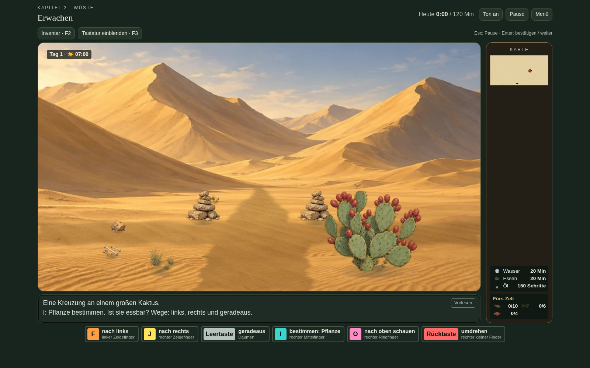
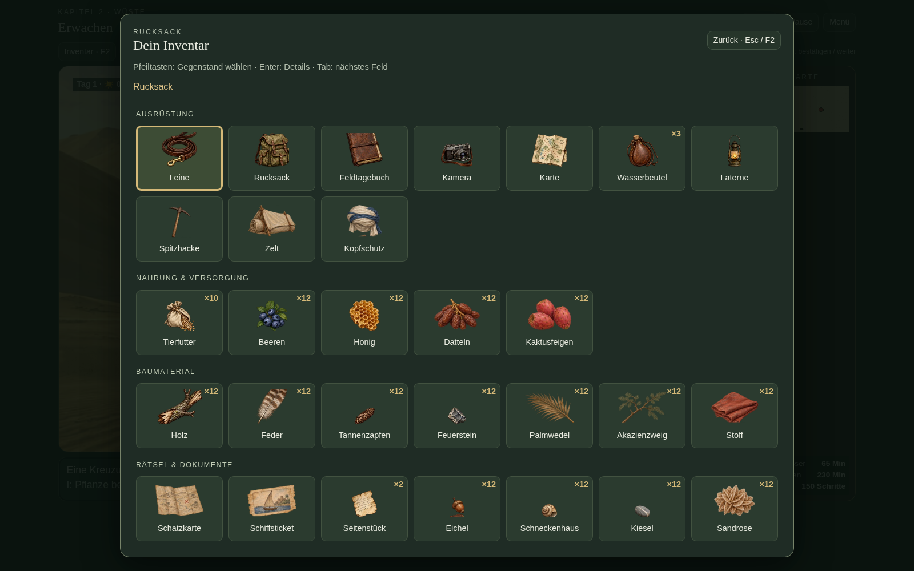
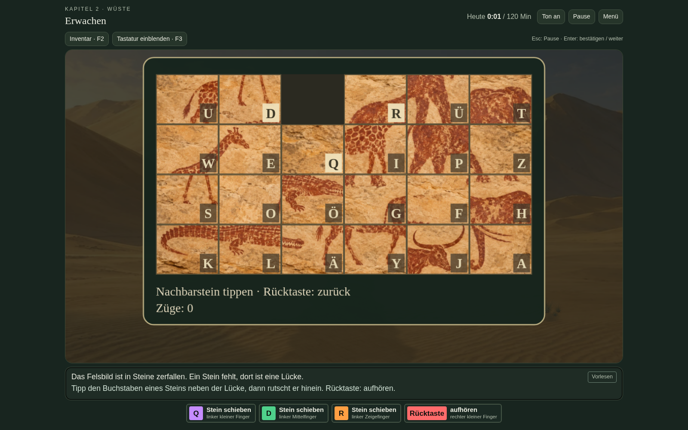
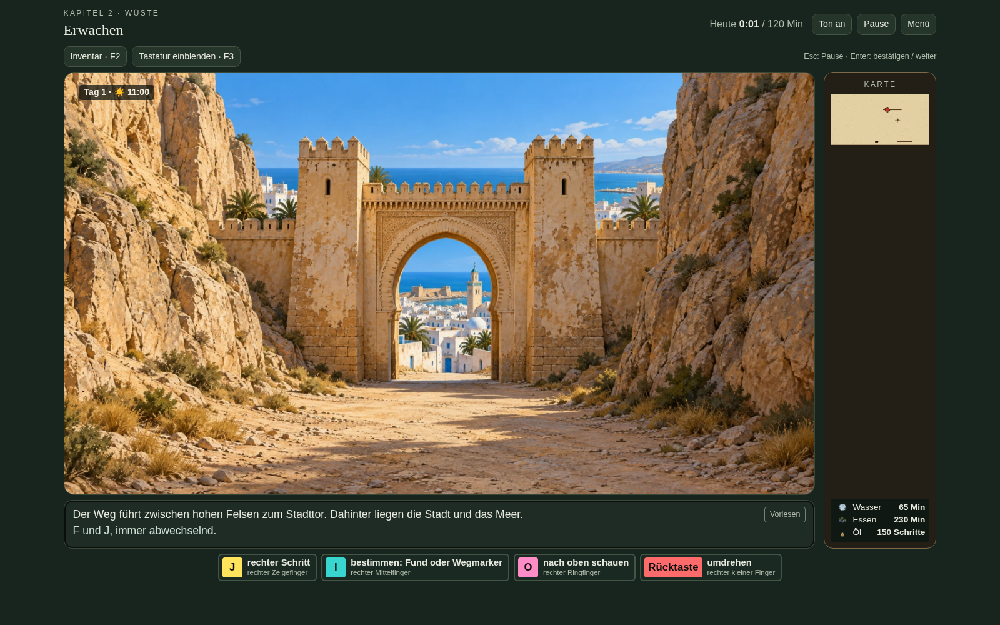
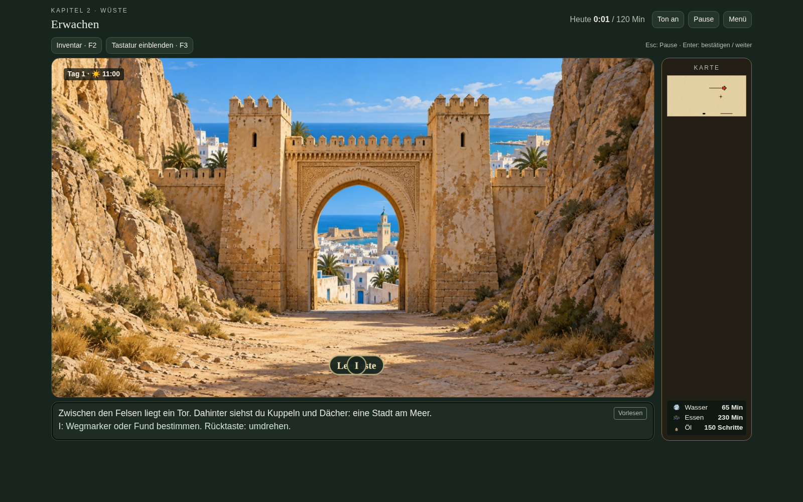
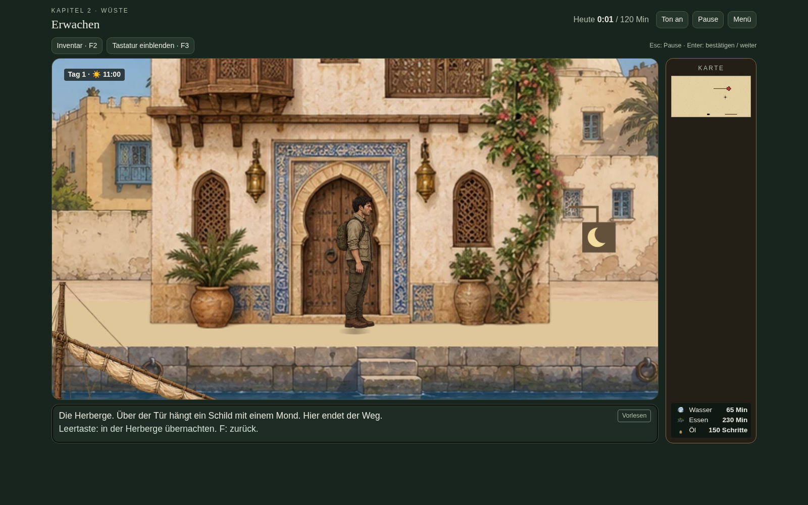

# Version 17 – Desktopansicht

Die Bilder zeigen das laufende Spiel bei 1600 × 1000 Pixeln Browsergröße. F2 öffnet das sortierte Inventar; F3 blendet die Bildschirmtastatur ein oder aus. Die eingeblendeten Aktionstasten behalten ihre Fingerhinweise.

## Größeres Spielfeld

## Inventar auf F2

Pfeiltasten und Tab wählen die Gegenstände. Enter zeigt Name und Menge. Anfang/Ende springen zum ersten/letzten Gegenstand, Bild auf/ab scrollen. Escape/F2 schließen die Übersicht. Währenddessen pausiert das Spiel.

## Größeres Schieberätsel

Die rechte Spalte entfällt vorübergehend; das Felsbild selbst ist zusätzlich um 20 Prozent vergrößert. Die ursprünglichen Buchstaben bewegen die Steine. Rücktaste oder Escape verlassen das Rätsel.

## Küstenweg zum Stadttor

Dieselbe Felskulisse gilt auf der gesamten letzten Wegkante in Richtung Stadt. Ein dezenter Zoom führt zur Nahansicht. Vorhandene Gegenstände, Tiere und gespeicherte Fußspuren bleiben Teil der Szene.

## Herberge im Verhältnis zur Figur

Die Prüfung `check-desktop-v17.py` nutzt tatsächliche Tastendrücke für Pause/Enter, Inventar, Fokus und Scrollen, F3, Menüwahl, Weitergehen nach einem Fund und einen Schieberätselzug. Zusätzliche Fensterbreiten: 900, 1280 und 1920 Pixel.
