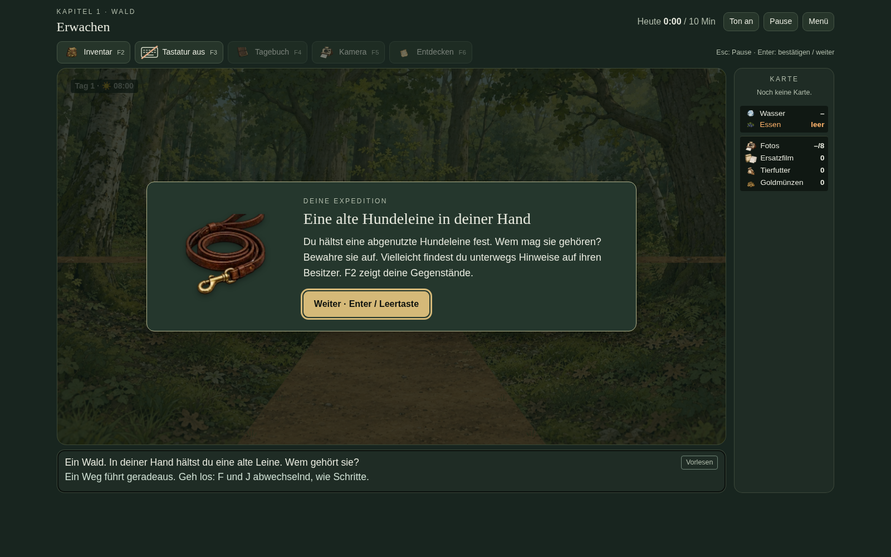
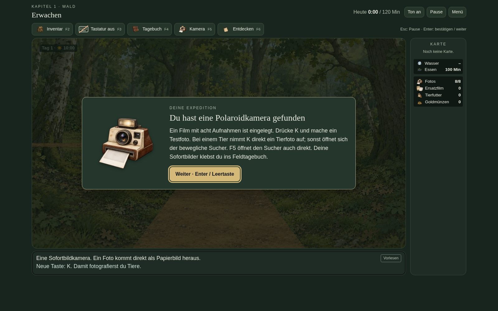
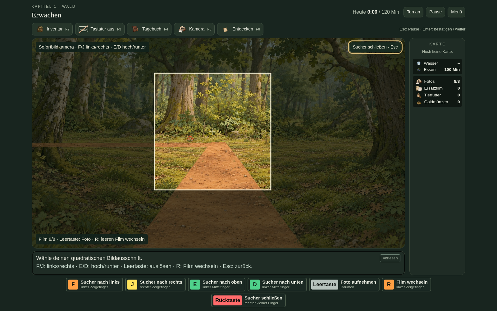
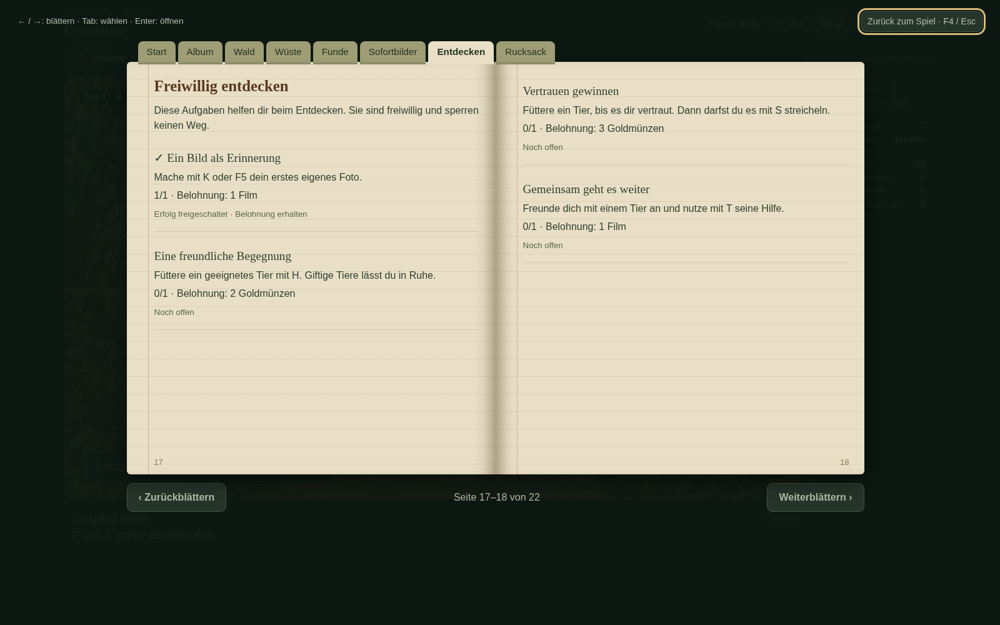
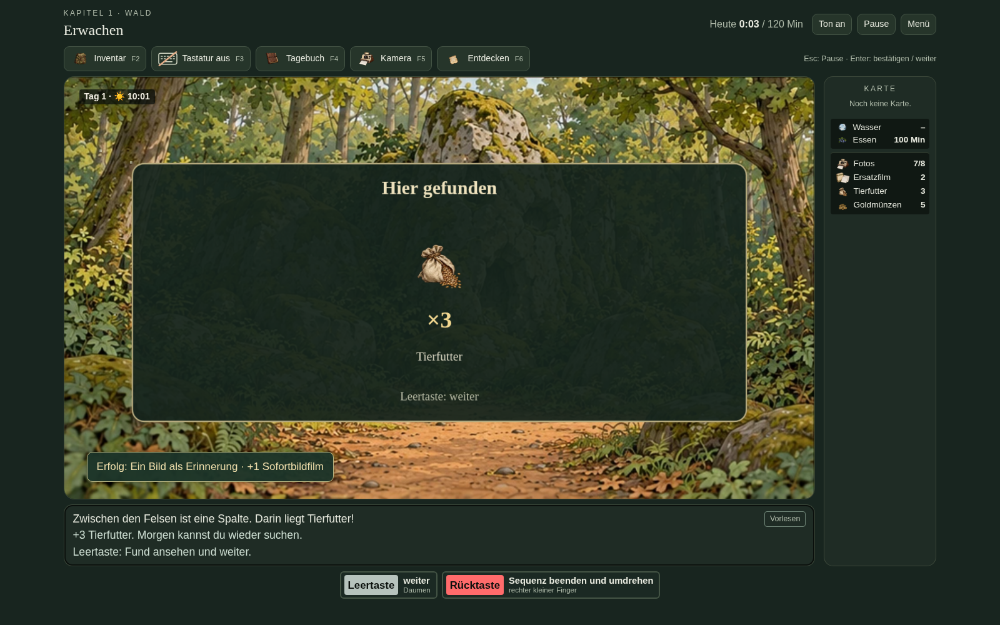
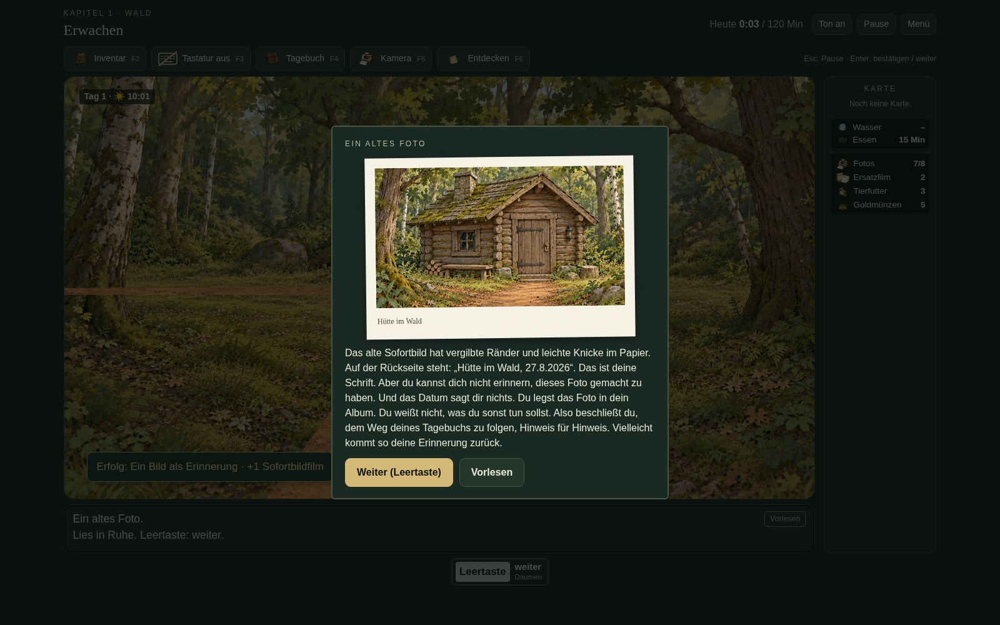
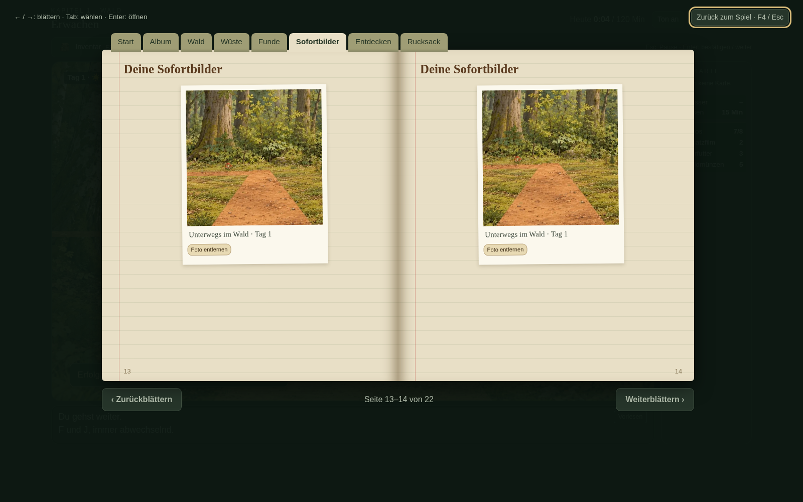
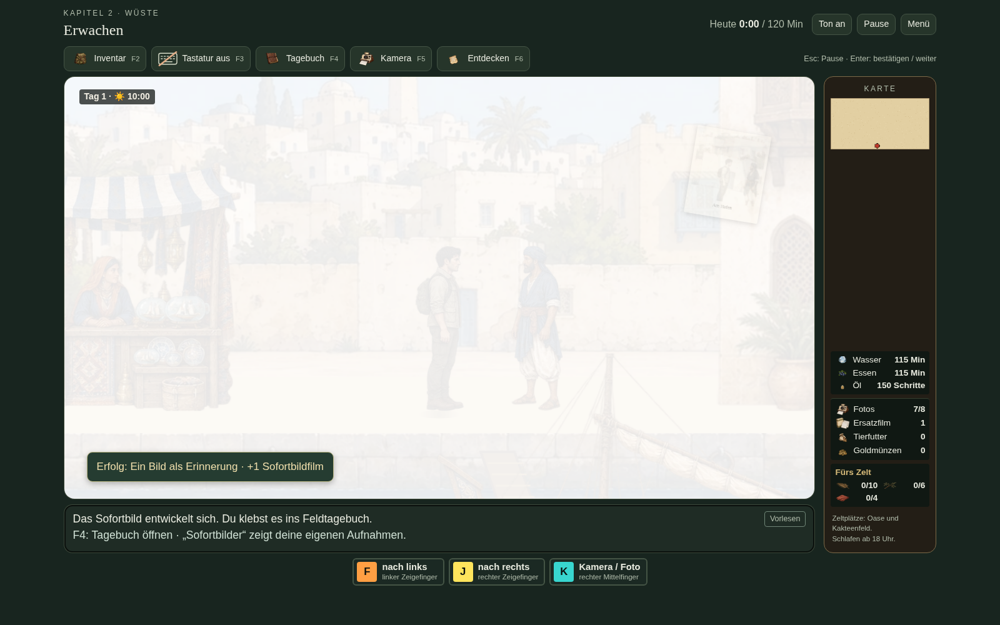

# Version 18 – Sofortbilder und Entdecken

## Hundeleine und Symbolleiste

F2 öffnet das Inventar, F3 schaltet die Bildschirmtastatur um, F4 öffnet das Feldtagebuch ohne Neustart, F5 die Kamera und F6 die freiwilligen Entdeckeraufgaben. Das Tastatursymbol zeigt den aktuellen Zustand.

## Polaroidkamera und Sucher

Ein Film enthält acht Aufnahmen. Der erste Film liegt im Rucksack; weitere können auf den Wegen gefunden werden. F/J bewegen den Sucher seitlich, E/D nach oben/unten, Leertaste löst aus und R wechselt einen leeren Film. Escape schließt ohne Filmverbrauch. K nimmt ein Tierfoto direkt auf oder öffnet den freien Sucher.

## Freiwillige Aufgaben

Die Aufgaben geben kleine, einmalige Belohnungen. Keine sperrt einen Weg. Vertrauen und Freundschaft erklären nach und nach S zum Streicheln und T für Tierhilfe.

## Fundanzeigen außerhalb von Truhen

Auch Untersuchen, Pflücken und Aufheben zeigen Gegenstand und tatsächliche Menge. Bereits automatisch verbrauchte Nahrung wird dabei als tatsächlicher Fund berücksichtigt. Die Anzeige zahlt nichts ein zweites Mal aus.

## Zusammenhängende Bilder

Das Hüttenbild besteht aus dem vollständigen ursprünglichen Motiv. Es werden keine Dachteile versetzt oder Szenenstücke neu zusammengesetzt. Bereits gespeicherte fehlerhafte Hinweisbilder werden erneuert; Fundstatus und Datierungen bleiben erhalten. Die eigenen Aufnahmen erhalten je eine Tagebuchseite.

Die Bilder stammen aus Browserprüfungen mit tatsächlichen Tasteneingaben. Kamerabewegung, Filmverbrauch und Nachladen, Abbruch, Albumgrenze und Löschen, Tierfotos, Aufgabenbelohnungen, Funde, Tagebuch-Rückkehr sowie Speichern/Neuladen wurden geprüft. Die eigenständige ZIP enthält alle 37 Bildbögen und lädt keine externen Bilder nach.
