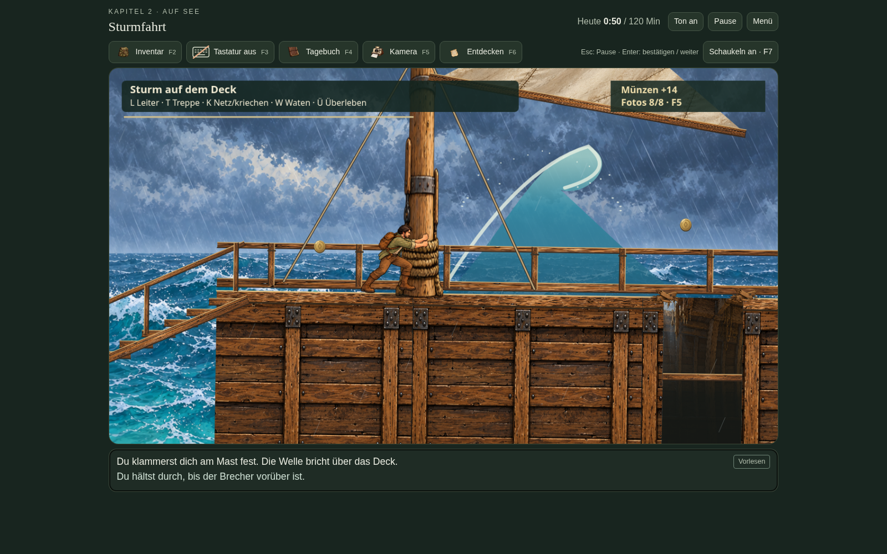
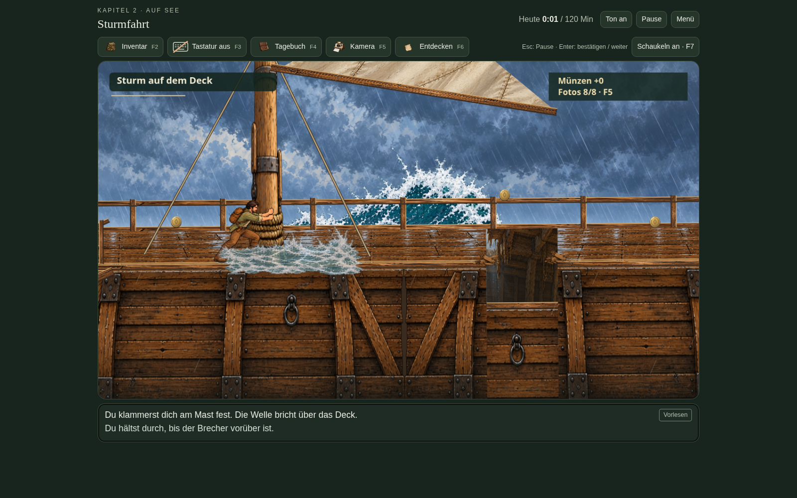
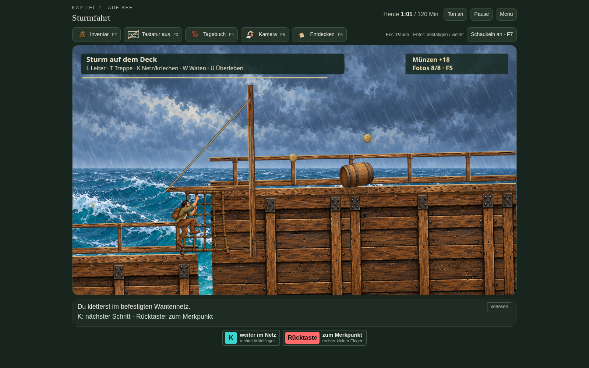
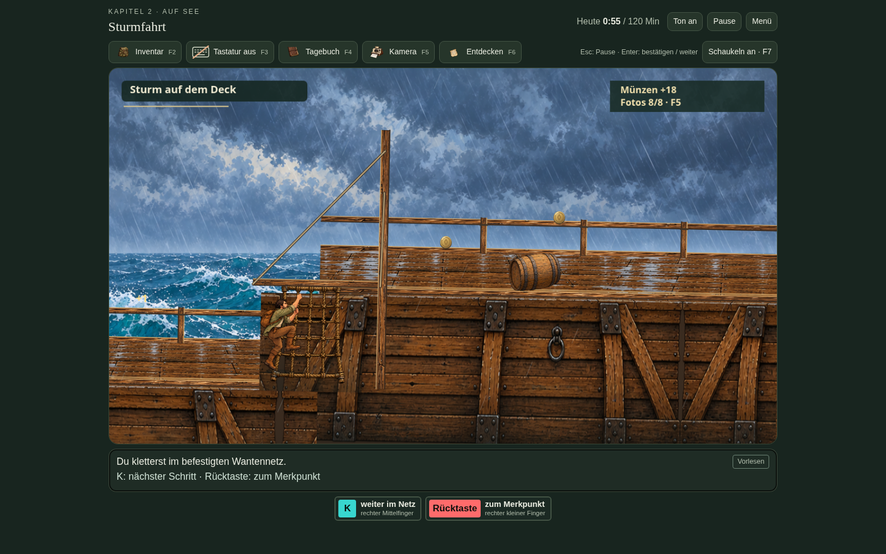

# Optische Überarbeitung der Sturmfahrt · Version 21.1

Aufnahmen aus der spielbaren Fassung. Zum Vergleich dient der [freigegebene Sturmdeck-Entwurf](../schiff-entwuerfe/05-korrigiertes-sturmdeck.png).

## Vorher und überarbeitet

| Version 21 | Version 21.1 |
| --- | --- |
|  |  |
|  |  |

## Weitere Spielszenen

- [Abgesenkter Segelbaum mit Beschlag und Tauen](03-unter-dem-segelbaum.png)
- [Seitlicher Aufgang zum höheren Deck](07-seitliche-treppe.png)
- [Eingestürzte Balken im Rumpf](12-kriechen.png)
- [Übergang unter die Wellen](16-blaue-wellen.png)

Der Testlauf hat die gesamte Strecke mit Tastatur durchlaufen. Die Illustration ist überarbeitet; die vorhandene Steuerung und gespeicherte Schiffsposition bleiben erhalten. Zum direkten Ausprobieren das neue ZIP entpacken und Schiff-Test.html öffnen.
